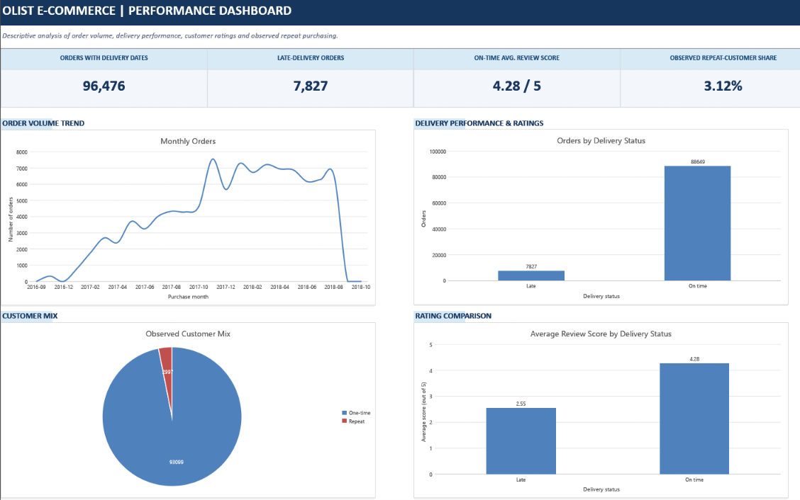
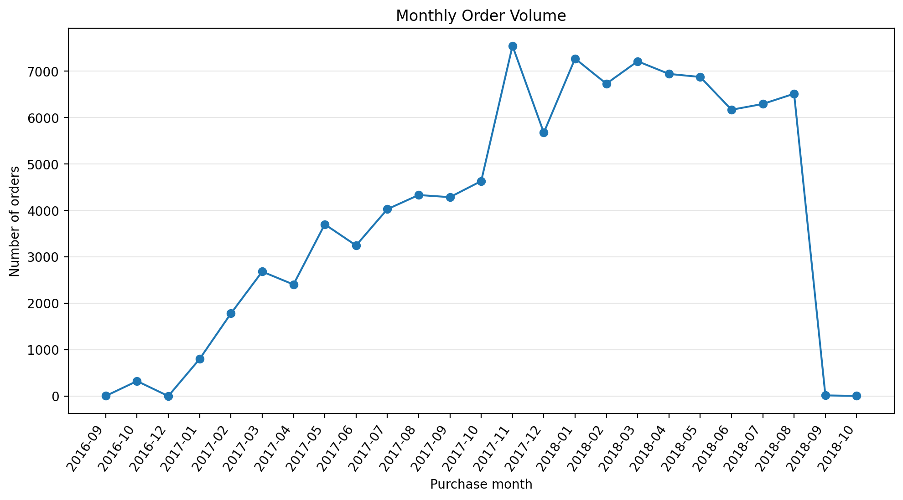
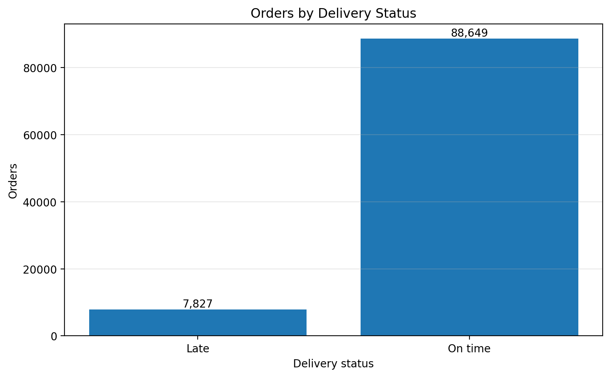
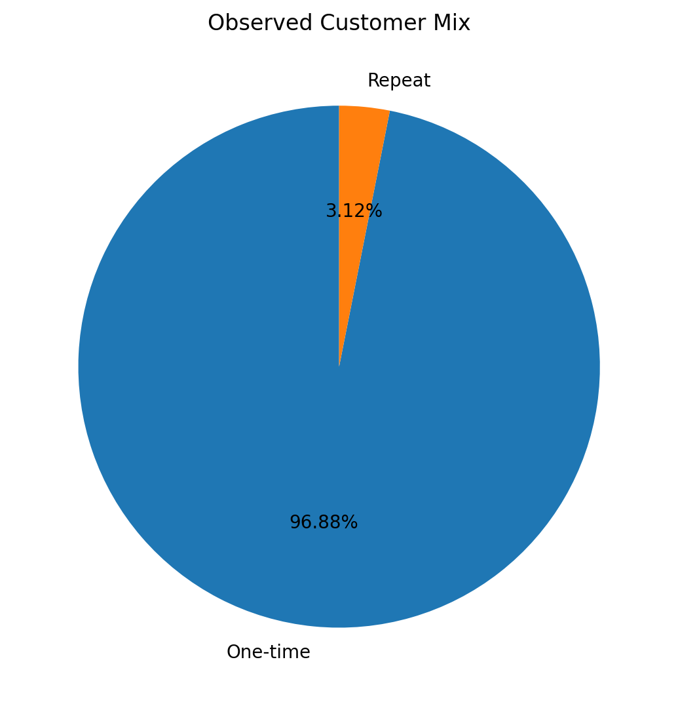
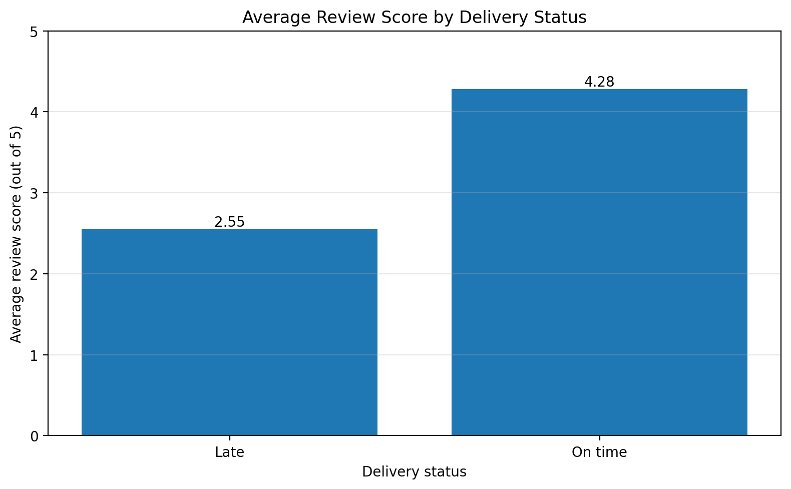

# Olist E-commerce Business Analysis

An end-to-end analysis of the Brazilian Olist E-commerce marketplace dataset to evaluate sales trends, delivery performance, customer satisfaction, and repeat purchasing behaviour.

The project focuses on transforming raw e-commerce data into meaningful business insights and actionable recommendations using Python, Excel, and data visualization.

## 1. Project Objectives

- Analyse monthly order trends to understand marketplace growth.
- Evaluate the relationship between delivery performance and customer satisfaction.
- Measure observed repeat-customer behaviour.
- Identify potential operational and customer-retention improvement opportunities.
- Present findings through an Excel dashboard and business recommendations.

## 2. Tools & Technologies

| Category | Tools |
|---|---|
| Programming | Python |
| Data Analysis | Pandas, NumPy |
| Data Visualization | Matplotlib, Seaborn |
| Spreadsheet Analysis | Microsoft Excel |
| Development Environment | Google Colab |

## 3. Key Business Findings

### Finding 1: Order Growth
Monthly orders increased from **800 in January 2017 to 7,544 in November 2017**, indicating substantial marketplace growth during this period.

### Finding 2: Delivery Performance & Customer Satisfaction
- Late-delivery orders recorded an average review score of **2.55/5**.
- On-time orders recorded an average review score of **4.28/5**.

This indicates a strong association between delivery performance and customer ratings, although it does not establish causation.

### Finding 3: Repeat Customer Behaviour
- Total unique customers: **96,096**
- Repeat customers: **2,997**
- Observed repeat-customer rate: **3.12%**

The result highlights an opportunity to investigate customer retention and repeat purchasing.

## 4. Dashboard & Visualizations

The Excel dashboard provides a consolidated overview of marketplace performance, highlighting order volume, delivery efficiency, customer ratings and observed repeat purchasing.

### Complete Excel Performance Dashboard



### 4.1 Monthly Order Trend

Shows changes in monthly order volume over the available historical period.



### 4.2 Delivery Performance

Compares the number of orders delivered late and on time.



### 4.3 Customer Mix

Displays the distribution of one-time and repeat customers.



### 4.4 Customer Rating Comparison

Compares average customer review scores between late and on-time deliveries.



## 5. Business Recommendations

Based on the observed findings, the following actions are recommended:

1. **Investigate Delivery Performance:** Analyse delivery delays across sellers, regions, and product categories to identify potential operational bottlenecks.
2. **Conduct Targeted Improvement Pilots:** Test delivery-improvement initiatives in selected problem areas and measure their impact on delivery reliability and customer satisfaction.
3. **Evaluate Customer Retention Initiatives:** Test follow-up engagement or second-purchase incentives using comparison groups to measure incremental repeat purchasing.

## 6. Repository Structure

```text
Olist-Ecommerce-Business-Analysis/
│
├── README.md
│
├── notebooks/
│   └── Olist_Ecommerce_Business_Analysis.ipynb
│
├── outputs/
│   └── Olist_Ecommerce_Business_Analysis_Findings.xlsx
│   └── Action Plan.pdf
│
└── images/
    ├── 01_monthly_order_trend.png
    ├── 02_orders_by_delivery_status.png
    ├── 03_observed_customer_mix.png
    └── 04_average_review_by_delivery_status.png
```

## 7. Dataset

**Dataset:** Brazilian E-Commerce Public Dataset by Olist

**Source:** [Kaggle – Brazilian E-Commerce Public Dataset](https://www.kaggle.com/datasets/olistbr/brazilian-ecommerce)

The dataset contains anonymized historical e-commerce marketplace information, including orders, customers, products, sellers, payments, and reviews.

## 8. Analytical Limitations

- The analysis is based on historical data and reflects the available observation period.
- Missing delivery dates were excluded from the relevant delivery-performance comparison.
- The relationship between delivery timing and customer ratings is observational and does not establish causation.
- The repeat-customer rate represents observed purchasing behaviour within the available dataset, not necessarily long-term customer retention.
- September and October 2018 contain partial-month data and should not be directly compared with complete months.

## 9. Author

**Prateek Kumar**  
Delhi Technological University (DTU)  
B.Tech – Production and Industrial Engineering

**Areas of Interest:** Business Analysis | Data Analytics | Process Improvement | Business Intelligence
